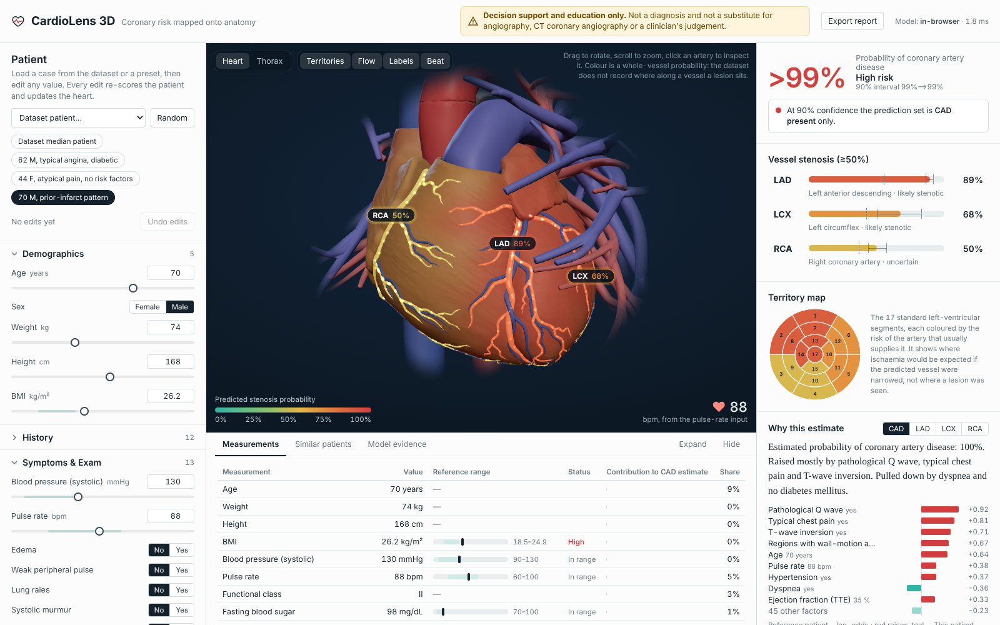

# CardioLens 3D

**Coronary artery disease risk, mapped onto a real 3D heart, with the reasons behind every number.**

CardioLens takes 54 routine clinical inputs (demographics, history, examination, ECG, labs, echo) and predicts:

- overall coronary artery disease (CAD)
- significant (≥50%) stenosis of the **LAD**, **LCX** and **RCA**

It then paints those predictions onto an anatomically accurate, interactive heart and torso in the browser. Every estimate comes with:

- an exact explanation
- a calibrated uncertainty interval
- a conformal "I'm not sure" signal
- the most similar real patients and what angiography actually showed for them

Built for **Multimodal AI Hackathon 2026 (IIT Mandi), Track A: Cardiovascular Risk Visualization & Prediction.**

> ⚠️ **Decision support and education only.** Not a diagnosis, and not a substitute for coronary angiography, CT coronary angiography or a clinician's judgement.



---

## What makes it different

| | |
|---|---|
| **Real anatomy, real vessels** | The heart, the coronary tree (LAD with diagonals and septals, LCX, RCA with marginal, PDA and posterolateral branches), the great vessels, lungs, ribs and body surface all come from **BodyParts3D**. Each coronary branch is its own named mesh, bound to its model output through a config registry. |
| **Spatial risk mapping** | Vessels are coloured by calibrated probability. The myocardium is tinted by **perfusion territory**, using per-vertex soft assignment to the nearest coronary tree. An **AHA 17-segment bullseye** mirrors it in 2D. **Flow particles** run along centrelines extracted from the vessel meshes, and the heart **beats at the patient's pulse-rate input**. |
| **Anatomically consistent model** | P(vessel) = P(CAD) × P(vessel \| CAD). On identical folds this matches the discrimination of direct vessel models and improves calibration for all three vessels. It also removes the **704** out-of-fold cases where direct models rated a vessel as more likely stenotic than CAD itself. A red artery can never appear on a "no CAD" heart. |
| **Validation of the whole pipeline** | Repeated (5×5) outer CV, with algorithm choice, hyper-parameters, Platt calibration, Youden thresholds and conformal quantiles all fit **inside** each training fold. 9 algorithms were compared with nested CV. Sanity checks include a label-permutation test (AUC 0.49) and a leakage demonstration (AUC 0.997 if the vessel columns were used as inputs). |
| **Exact explanations** | The models are additive (logistic), so per-feature contributions are **exact interventional SHAP** (they match `shap.LinearExplainer` to 4e-16). Hierarchical vessels use closed-form integrated gradients that sum exactly to the patient's log-odds. These are not sampled approximations. |
| **Honest uncertainty** | A bootstrap 90% interval on every probability, plus **Mondrian conformal prediction sets** at 90%. Empirical coverage is 88–90%, so the UI says "uncertain" when the model can't decide. |
| **Runs anywhere** | FastAPI model server, plus an identical in-browser engine (tested to 1e-9 on all 303 patients). No GPU is needed, and it keeps working offline. |
| **Extensible by config** | `ml/features.py` (inputs), `config/registry.json` (targets → meshes → AHA segments), `anatomy/anatomy_registry.json` (meshes). Adding a lab value, a target or a structure doesn't need a redesign. |

## Results

Mean ± SD over 25 outer folds (5-fold × 5 repeats) of the **complete** pipeline. The operating threshold is chosen inside each fold (Youden J); n = 303.

| Target | Model | ROC-AUC | PR-AUC | Accuracy | Precision | Recall | Specificity | F1 | Brier | Conformal coverage (90%) |
|---|---|---|---|---|---|---|---|---|---|---|
| CAD | Logistic (L2) | **0.928 ± 0.029** | 0.970 | 0.845 | 0.947 | 0.830 | 0.883 | 0.883 | 0.098 | 90.0% |
| LAD | P(CAD) × logistic (L1) | **0.849 ± 0.040** | 0.882 | 0.771 | 0.799 | 0.816 | 0.712 | 0.803 | 0.155 | 89.4% |
| LCX | P(CAD) × logistic (L1) | **0.706 ± 0.054** | 0.578 | 0.643 | 0.532 | 0.810 | 0.537 | 0.638 | 0.207 | 88.3% |
| RCA | P(CAD) × logistic (L1) | **0.738 ± 0.050** | 0.604 | 0.642 | 0.517 | 0.830 | 0.532 | 0.633 | 0.198 | 89.2% |

Pooled out-of-fold ROC-AUC 95% bootstrap CIs:

- CAD: 0.899–0.956
- LAD: 0.792–0.884
- LCX: 0.633–0.751
- RCA: 0.673–0.792

The full model card (ROC, calibration, decision curves, subgroups, algorithm comparison) is in [`ml/artifacts/model_card.json`](ml/artifacts/model_card.json) and in the app's **Model evidence** tab.

On 303 patients, gradient boosting, random forests, SVMs and EBMs landed within about ±0.01 AUC of regularised logistic regression on CAD, LAD and RCA. Tree ensembles gained about 0.02 AUC on LCX. We kept the glass-box model so explanations stay exact and identical in the browser.

## Quick start

### Option A: Docker (one command)

```bash
docker compose up --build
# open http://localhost:8000
```

### Option B: local development

Prerequisites: Python 3.11+ (tested on 3.13) and Node 18+ (tested on 22).

```bash
pip install -r requirements.txt            # serving + training
cd frontend && npm ci && cd ..

# terminal 1: model server
uvicorn backend.app.main:app --port 8000

# terminal 2: web app with hot reload (proxies /api to :8000)
cd frontend && npm run dev                  # http://localhost:5173
```

### Option C: static, no server

```bash
cd frontend && npm run build && npx serve dist   # or any static host (GitHub Pages, Netlify, Vercel)
```

Without a reachable `/api`, the app switches to the in-browser engine. The header shows **Model: in-browser**, and the numbers are identical.
For hosts that only serve standard web types, build with `VITE_STATIC_DEMO=1 npm run build`: it loads the anatomy from `heart_scene.json` (the same model as embedded glTF, made by `anatomy/glb_to_gltf_json.py`) and hides the print button.

## Reproduce everything

All randomness is seeded (`SEED = 42`). The trained artifacts are committed, so these steps are only needed to regenerate them.

```bash
pip install -r requirements-dev.txt
cd ml
python compare_models.py --repeats 5        # 9 algorithms × 4 targets, nested CV   -> results/compare_*.json   (~1 h on 2 cores)
python structure_ablation.py 5              # direct vs hierarchical, paired        -> results/structure_ablation.json
python verify_shap.py                       # attributions vs the shap library      -> results/shap_check.json
python train_final.py --repeats 5 --boot 60 # evaluate full pipeline, fit, export   -> artifacts/ + frontend/public/data/app_data.json
cd ..
python -m pytest -q tests                   # parity (sklearn = Python engine = browser engine), invariants, API contract
```

Anatomy (only needed to rebuild the 3D scene):

```bash
git clone --depth 1 https://github.com/Kevin-Mattheus-Moerman/BodyParts3D   # mirror of BodyParts3D 4.0 STL files
python anatomy/build_anatomy.py --stl BodyParts3D/assets/BodyParts3D_data/stl
npx @gltf-transform/cli meshopt frontend/public/anatomy/heart_scene.glb frontend/public/anatomy/heart_scene.glb
```

## How it works

```
 Z-Alizadeh Sani extension (303 × 59)
        │  ml/features.py      feature registry: 54 inputs, units, reference ranges; LAD/LCX/RCA/Cath excluded (asserted)
        ▼
 ml/cardio_model.py   CardioModel = per-target additive scorer (L1/L2 logistic, chosen in inner CV)
        │             + Platt calibration + Youden threshold + Mondrian conformal + bootstrap (60)
        │             CAD direct; vessels hierarchical: P(v) = P(CAD)·P(v | CAD)
        ▼
 ml/train_final.py    5×5 outer CV of the whole pipeline → model card; final fit → model_bundle.json (portable weights)
        │
        ├──► backend/app/main.py   FastAPI: /api/predict, /api/whatif, /api/meta … (ml/engine.py over the bundle)
        └──► frontend/src/lib/engine.ts   same arithmetic in the browser (fallback / offline)
                     │
 anatomy/build_anatomy.py  BodyParts3D STL → cleaned, decimated, re-oriented GLB (named meshes, territory weights in COLOR_0)
                     │                       + vessel centrelines (voxelise → skeletonise → graph paths)
                     ▼
 frontend (React + React Three Fiber)  3D viewer · assessment rail · explanations · evidence · what-if · report
```

### API

| Method | Path | Purpose |
|---|---|---|
| GET | `/api/health` | liveness, model timestamp |
| GET | `/api/meta` | feature schema, target registry, model card, presets |
| GET | `/api/patients/{id}` | a dataset patient with angiography labels and out-of-fold scores |
| POST | `/api/predict` | `{"inputs": {...}}` → probabilities, intervals, conformal sets, attributions. Missing inputs are filled with the median patient and listed in `warnings`. Add `?check=true` to also score through the original sklearn pipelines. |
| POST | `/api/predict/batch` | up to 1000 patients |
| POST | `/api/whatif` | `{"inputs": {...}, "changes": {...}}` → before / after / delta |

Interactive docs are at `http://localhost:8000/docs`.

### Extending

- **New clinical feature:** add a `Feature(...)` to `ml/features.py` and re-run `train_final.py`. The form, API validation, explanations and measurements table pick it up automatically.
- **New target or vessel:** add it to `TARGETS` in `ml/features.py` and to `config/registry.json`, then tag its meshes with `"target": "<id>"` in `anatomy/anatomy_registry.json`.
- **New anatomical structure:** add an entry with its FMA id(s) to `anatomy/anatomy_registry.json` and re-run `build_anatomy.py`.

## Repository layout

```
ml/            features.py · models.py · cardio_model.py · engine.py · compare_models.py · structure_ablation.py
               verify_shap.py · train_final.py · artifacts/ (weights, bundle, model card) · results/ (experiments)
backend/app/   FastAPI server
frontend/      React + TypeScript + React Three Fiber app (src/three = 3D scene, src/components = dashboard)
anatomy/       BodyParts3D → GLB pipeline and anatomy registry
config/        target ↔ mesh ↔ AHA-segment registry
tests/         parity, invariants, API contract (17 tests)
docs/          project documentation (PDF), demo video script, screenshots
data/          the dataset (CC BY 4.0)
```

## Limitations

- 303 patients from a single Iranian centre. The model is not externally validated.
- Labels are vessel-level. The dataset does not record **where** along a vessel a lesion sits, so the whole vessel is coloured and the UI says so.
- Territory tinting uses nearest-vessel assignment on a reference heart. Real perfusion territories vary between patients (for example, right- vs left-dominant circulation).
- Vessel-level discrimination is lower in patients ≥ 60 and in diabetics (see subgroups in the model card).
- Some associations reflect treatment rather than biology. For example, lower LDL is linked to higher risk, plausibly because patients with known disease are already on statins. The "Modifiable factors" panel flags this and labels its output as model sensitivity, not treatment effect.

## Credits and licences

- **Dataset:** Alizadehsani R., Roshanzamir M., Sani Z. (2013). *Extention of Z-Alizadeh Sani dataset.* UCI Machine Learning Repository. [doi:10.24432/C5461K](https://doi.org/10.24432/C5461K). CC BY 4.0.
- **Anatomy:** BodyParts3D, © 2008 Life Science Integrated Database Center, licensed under CC BY-SA 2.1 Japan. The derived GLB (`frontend/public/anatomy/`) is shared under the same licence.
- **AHA 17-segment model:** Cerqueira M.D. et al., *Circulation* 2002;105:539–542.
- **Code:** MIT licence (see `LICENSE`).
